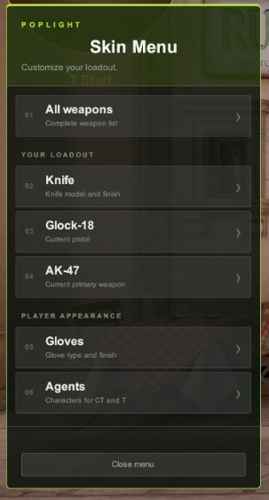

# PopLight WeaponPaints CS2

A fully working and hopefully optimized version of CS2 WeaponPaints with a clickable Panorama menu for weapons, knives, gloves and agents.

Open the menu using `.ws` or `!ws` in chat, or `css_ws` in the console.



## Features

- One menu for weapons, knives, gloves and agents, with quick access to your current pistol and primary weapon.
- Knife model selection, glove categories and individual skin selection.
- Knife and glove settings for your current team or both CT and T.
- A clickable, color-coded wear bar for weapons, knives and gloves, with Factory New, Minimal Wear, Field-Tested, Well-Worn and Battle-Scarred ranges.
- A StatTrak checkbox above the wear bar for weapons and knives, preserving existing kill counters when changing skins.
- Highlighted current selections for skins, knife models, glove models and agents. Skin matching uses the exact paint kit ID to distinguish variants such as Doppler phases.
- CT/T markers when a selection applies to only one side while editing both teams.
- Immediate agent changes with previews that keep the selection menu open.
- MySQL persistence for cosmetic settings, wear and StatTrak counters.
- Workshop-delivered Panorama resources, with editable layout and style sources included in the repository.
- English and Slovak interface translations, per-player language selection and server-side text customization.

## Recent improvements — 0.3.2

- New skins and models are added automatically after CS2 update.

## Recent improvements — 0.3.1

- Replaced direct Kill calls in RefreshWeapons() with the engine’s native weapon-removal routine for knives, rifles, and pistols. The routine detaches the old entity from WeaponServices.MyWeapons before deletion, preventing stale CHandle entries from accumulating.
- Applied the same cleanup to temporary weapons created during knife refresh if they were added to the player’s inventory.
- Rifle and pistol replacements are queued only after the old handle is gone. The replacement keeps the original magazine and reserve ammo.
- The Back button takes you back to the last page you opened, not to the beginning.
- Fixed a bug where the vanilla skin was displayed instead of the selected skin, especially with “Tiger Tooth.” Still being tested!!!

## Recent improvements — 0.3.0

- Add wear controls, the StatTrak checkbox and current-selection highlighting, together with fixes to cosmetic updates and persistence:
- Delayed operations are guarded against reconnects, team changes, pawn replacements and map changes.
- Selecting a weapon or knife skin refreshes only the relevant weapon instead of rebuilding the entire inventory. Overlapping refresh requests are combined during rapid switching, including pending changes to different weapon types.
- Database writes use independent snapshots of cosmetic settings, reducing SQL queries and keeping T and CT data separate.
- StatTrak counts the weapon responsible for the kill. Grenade kills no longer increase the counter of the weapon currently being held, and counter changes are saved as they occur.
- Fixed loading of incomplete data, combinations of disabled cosmetic features and overlapping agent previews.
- Faster skin lookup and a corrected plugin update check.

## Server requirements

- Metamod:Source.
- CounterStrikeSharp with runtime, compatible with the API version referenced in `WeaponPaints.csproj`.
- MultiAddonManager for Workshop menu delivery.
- MySQL or MariaDB.

CS2UIKit is included in `3rd_party` and copied alongside the plugin during compilation.

## Installation

1. Install Metamod, CounterStrikeSharp and MultiAddonManager.
2. Download the latest release and extract it into the server's `game/csgo` directory, merging the included folders.
3. Set `"FollowCS2ServerGuidelines": false` in CounterStrikeSharp's `configs/core.json`.
4. Start the server once, then enter your MySQL connection details in the generated `WeaponPaints.json` configuration.
5. Configure the Workshop menu as described below and restart the server.

Database tables are created and updated automatically. A missing database is also created if the MySQL account has sufficient permissions; otherwise, create it through your hosting panel first.

When upgrading to the wear controls and selection highlighting, update both the server plugin and the Workshop menu resources.

## Workshop menu

Add the [PopLight Skin Menu](https://steamcommunity.com/sharedfiles/filedetails/?id=3836442690) to your MultiAddonManager configuration:

```cfg
mm_client_extra_addons "3836442690"
```

Keep any existing addon IDs, separated by commas. Players download the menu when connecting and may need to confirm the download.

## Language and text customization

English (`en`) and Slovak (`sk`) are included.

Players can change their language in the game console:

```text
css_lang en
css_lang sk
```

Close and reopen the menu after switching languages. The server's default language is configured through `ServerLanguage` in CounterStrikeSharp's `configs/core.json`.

To customize interface text, edit the plugin's `lang/en.json` or `lang/sk.json` on the server, then restart the server. Preserve formatting placeholders such as `{0}`, `{1}` and `{0:00}`. Translation changes do not require recompiling or updating the Workshop addon.

Menu labels use plain text; their appearance is controlled by CSS. Chat messages support CounterStrikeSharp color tags.

`SkinsLanguage` is a separate plugin setting for cosmetic names loaded from `data`. Use a language available in that folder, such as `en` or `cs`. The Slovak interface does not require `SkinsLanguage` to be set to `sk`.

## Credits and licenses

PopLight customization and maintenance by [Siniiitchibo](https://github.com/Siniiitchibo).

Based on [Nereziel/cs2-WeaponPaints](https://github.com/Nereziel/cs2-WeaponPaints).

Panorama integration uses [CS2UIKit](https://github.com/nvmxre/cs2-ui-kit) by PROJECT ZERO.

Workshop delivery uses [MultiAddonManager](https://github.com/Source2ZE/MultiAddonManager).

The original project license is retained in `LICENSE`.
The CS2UIKit license is included in `3rd_party/CS2UIKit.LICENSE`.
